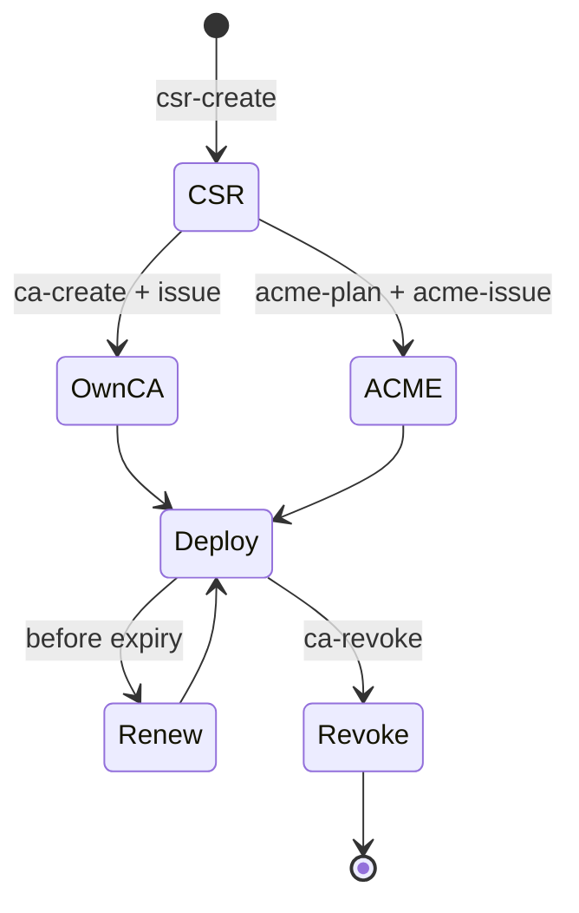

# OpenSSL


Certificate lifecycle toolkit — generation, issuance, renewal, and revocation without depending on the system `openssl` command.

## 💡 Why OpenSSL

You need to manage certificates programmatically — sign your own CAs, issue through ACME, store private keys safely, and automate renewal — and you do not want to shell out to a system `openssl` binary or embed a library you do not control.

## 🧩 Key capabilities

- **Full X.509 / ASN.1 / DER pipeline** — parsing, validation, and PEM encoding
- **ACME with multiple DNS flows** — `cloudflare` file-token mode (secrets-driven, no fallback) and `manual` interactive mode (operator places TXT records by hand)
- **Idempotent renewal + CRL** — every issuance leaves a persisted state that resuming or renewing can pick up
- **Private key storage** — Windows CNG and DPAPI containers, no plaintext keys on disk by default
- **Own CA issuance** — self-hosted PKI for internal services without reaching out to a public CA

## 🚀 CLI examples

```bash
# Plan an ACME issuance against Let's Encrypt staging
open-ssl acme-plan --kind staging --dns-provider cloudflare zzz.example.com --json

# Issue a staging certificate for one or more domains
open-ssl acme-issue --kind staging --dns-provider cloudflare zzz.example.com "*.zzz.example.com"

# Resume after placing the manual TXT record
open-ssl acme-issue --action <action-id>
```

Project-level defaults (DNS provider, zone id, contact) can live in `open-ssl.json` under the project root; CLI flags always override. No implicit fallback to environment variables.

## 📐 X.509 certificate lifecycle



The `acme-plan` / `acme-issue` flow writes a persisted plan that records account, order, pending DNS challenges, and delivery paths. `acme-issue --action <id>` resumes from an interrupted issuance, including manual DNS challenges where the operator places TXT records by hand.

## 🧱 Repository layout

| Path | Purpose |
|------|---------|
| Internal X.509 modules | X.509 parsing, name, verification, anchors |
| Internal ACME modules | ACME client, directory, JWS, challenge types |
| Internal DNS modules | DNS credential + Cloudflare provider |
| Internal TLS modules | TLS transport record and key exchange |
| Internal DER modules | ASN.1 DER reader / writer / OID table |
| Internal flow engine | Persisted issuance state machine |
| Native bridge | Bridge to TypeScript |
| `projects/open-ssl.ts/packages/open-ssl/` | TypeScript CLI entry + library wrapper |

## What it does NOT do

- **It is not affiliated with the OpenSSL project.** The name describes what the product does — open-source PKI tooling — and carries no upstream dependency.
- **It does not replace `openssl s_client` or a full TLS library.** TLS record handling is internal to the issuance flow; it is not exposed as a general-purpose TLS toolkit.
- **It does not implement every DNS provider.** Only `cloudflare` (token from project secrets file) and `manual` (operator-driven) flows are implemented. Others can be added.
- **It does not ship a web certificate viewer or CA management console.** The CLI is the authoring surface; a separate GUI shell is planned.
- **It does not read credentials from environment variables.** Secrets are loaded exclusively from the project root `.secrets/open-ssl.json` file — no implicit fallback, no parent-file discovery.

## ⚠️ Capability note

Some capabilities in the command tree (`certificate-inspect`, `certificate-renew`, `certificate-revoke`, `ca-create`, `csr-create`, and private-key-store flows) are declared as API contracts but are not yet implemented. They exit with a stable `not_implemented` code. The ACME issuance path is implemented and verified against Let's Encrypt staging.
